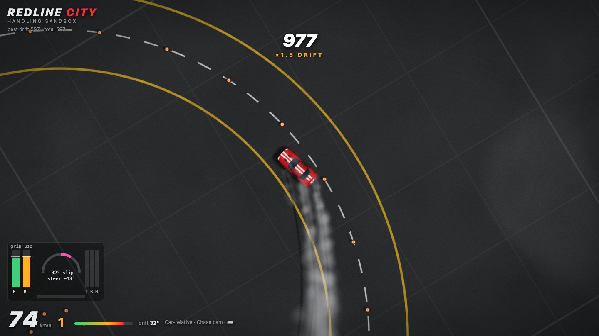
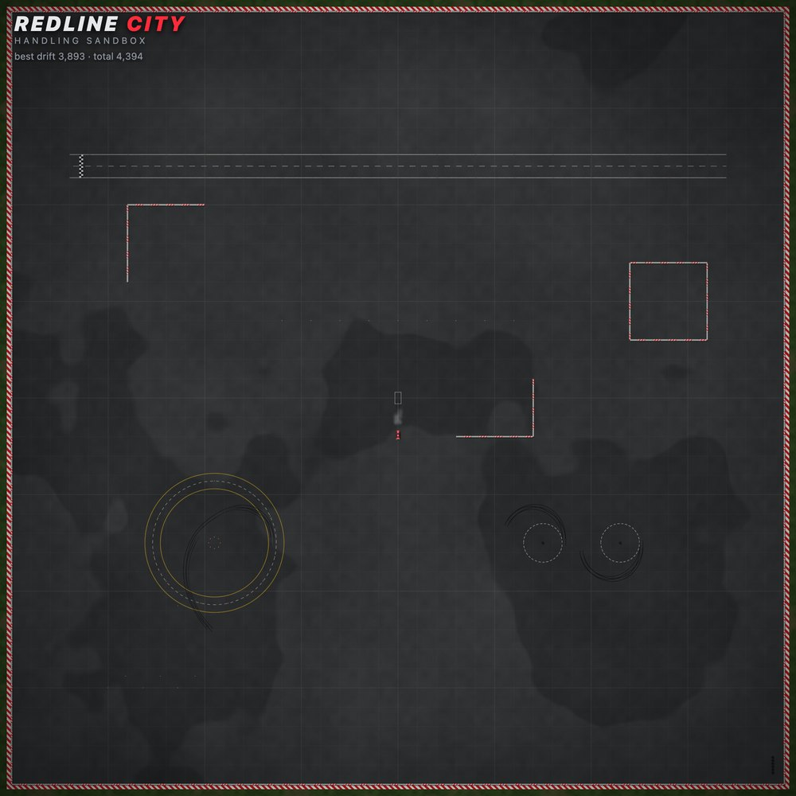
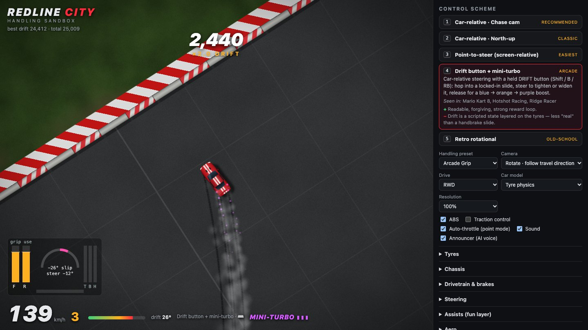
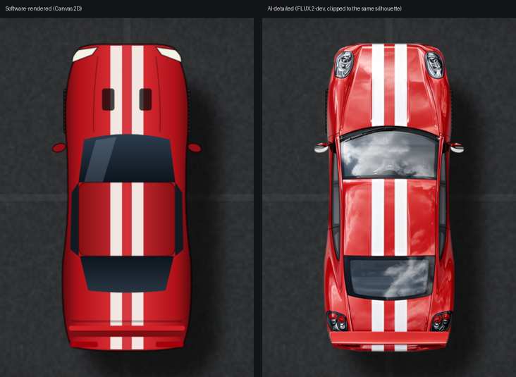
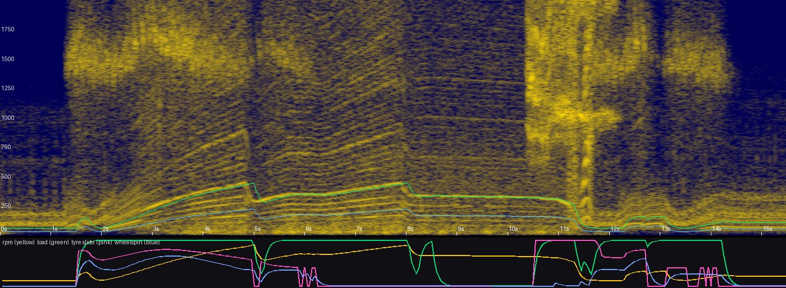

# Redline City — handling sandbox

Top-down arcade driving in WebGPU. This first milestone is a 400 m × 400 m test pad (skidpad, figure-8, slalom, drag strip, barrier blocks, cones and tyre stacks) for dialling in car feel.



<p align="center">
  
  <br><sub>The whole sandbox from above: drag strip, barrier blocks, slalom, skidpad and figure-8.</sub>
</p>

```bash
npm start            # node server.mjs → http://localhost:5173  (no dependencies)
```

Needs a WebGPU browser (Chrome/Edge 113+, Safari 26+, Firefox 141+). The server proxies Cloudflare Workers AI using `.env`, so the token never reaches the browser.

* **Localhost only:** the server listens on localhost by default, because the `/api` routes spend your Cloudflare quota. Use `HOST=0.0.0.0 npm start` to share it on a LAN.
* **AI call limit:** AI calls are capped at 20 per minute; cached voice lines don't count.
* **Hidden files:** dotfiles and dot-directories (`.env`, `.git/…`) are never served.

### GitHub Pages

`.github/workflows/pages.yml` publishes the game on every push to `main`, and can also be run by hand from the Actions tab. To enable it, go to **Settings → Pages → Build and deployment → Source** and choose **GitHub Actions**.

* **What's published:** only what the browser loads: `index.html`, `style.css`, `src/` and `assets/`. There's no build step.
* **What stays local:** the dev server, Python tools and docs are not published.
* **Without the dev server:** the Pages build has everything except the two dev-server AI features. The announcer is skipped, and *Detail car with AI* reports that it needs `npm start`.

## Layout

| file | what |
|---|---|
| `src/physics/car.js` | Vehicle model + tuning presets |
| `src/physics/world.js` | Sandbox layout, SAT car-vs-barrier, impulse collisions with cones/tyres |
| `src/controls.js` | The 5 control schemes (input → car commands) |
| `src/input.js` | Keyboard ramps, radial deadzone + response curve, Gamepad API, dual-motor rumble |
| `src/touch.js` | Tablet controls: tilt steering, touch pedals, full-tilt and jerk-handbrake modes |
| `src/camera.js` | Chase / locked / north-up camera, look-ahead, speed zoom, shake |
| `src/gpu/renderer.js` | WebGPU: procedural ground shader, persistent skid-mark render target, instanced sprites |
| `src/sprites.js` | Canvas 2D (software) sprite atlas + AI detail pipeline |
| `src/audio.js` | Sample-based V8 engine + tyres (real recordings), synth fallback, AI announcer |
| `server.mjs` | Static server + `/api/detail-car`, `/api/image`, `/api/voice` |

## Physics (the "real" half)

* Two-axle rigid body; tyre lateral force from slip angle through a simplified Pacejka curve `sin(C·atan(Bα))` — grip peaks at `peakSlipDeg`, then falls to a sliding plateau (`slideFalloff`).
* Longitudinal weight transfer: braking loads the front (turn-in / trail-brake rotation), lifting off unloads the rear (lift-off oversteer).
* Per-axle friction circle: wheelspin eats lateral grip → power oversteer on RWD.
* No-ABS lockup: locked tyres slide along their velocity, so you can't steer — ABS caps brake force at the grip limit.
* Handbrake locks the rear axle.
* Auto gearbox with a torque curve, rev limiter, and reverse (hold brake at a stop).

## Assists (the "fun" half) — all sliders

* **Auto-countersteer** (front wheels self-align to travel direction, like caster).
* **Spin protection** (soft torque past `maxDriftDeg`).
* **Slide speed retention** (sideways scrub gives back speed).
* **Stability control**.
* **Steer-to-grip limiter** (Forza-style: full stick doesn't plough the front).
* Player countersteer is exempt from speed-sensitive steering reduction.

## Control schemes (keys 1–5, or View button)

1. **Car-relative · chase cam** *(recommended)* — camera eases round to the travel direction (not the nose, so spins stay readable).
2. **Car-relative · north-up** — classic GTA 2 / Micro Machines; inverted feel when driving down-screen.
3. **Point-to-steer** — stick/arrows = direction you want to travel on screen; auto-throttle.
4. **Drift button + mini-turbo** — hold Shift/B/RB to lock into a slide, release for a 3-stage boost.
5. **Retro rotational** — no tyre model; steering spins the car, velocity lags the nose.

Handling presets: Balanced, Grip / Sim, Drift Car, Arcade Grip, Ice / Rally. Every setting persists in localStorage; *Copy tuning JSON* in the panel exports a config to bake into defaults.



## iPad / tablet controls

On touch devices, on-screen controls switch on automatically. Tap **Tap to start** to grant motion-sensor access (iOS asks here), unlock sound, and calibrate to however you're holding the device.

| Action | Control |
|---|---|
| Steer | Rotate the iPad like a steering wheel. Full lock is ±28° by default. |
| Gas / brake | Right / left thumb pedals. Slide up a pedal for more. |
| Handbrake / drift | Buttons above the pedals. |
| ⟲ ↺ ⚙ | Recentre tilt, reset car, settings panel (top right). |

* **Modes** (panel → *Touch & tilt*):
  * **Tilt steer + pedals** (default).
  * **Full tilt:** tilt the top edge away to accelerate and pull it back to brake, with a dead zone and range around the calibrated angle.
  * **Touch buttons only:** ◀ ▶ arrows replace tilt steering.
* **Jerk back = handbrake** is optional. It detects a fast pull of the top edge toward you, at sensor rate. Steering holds its pre-flick value so the yank doesn't jerk the wheel.
* **Robustness:**
  * Steering is the rotation of gravity within the screen's plane relative to the calibrated neutral. That makes it independent of landscape direction, of how far back the device is tilted, and of iOS/Android sign conventions.
  * It fades out when the device lies flat, and recentres automatically when the device is turned round.
* **Fallbacks:** without a motion sensor, or if access is denied, ◀ ▶ arrows appear for steering. Bluetooth controllers and keyboards keep working.
* **HTTPS is required for motion sensors.** GitHub Pages works as-is. For the local dev server, use an HTTPS tunnel. Be aware a tunnel also exposes the `/api` routes, which are rate-limited.
* **Full screen:** *Add to Home Screen* in Safari runs it full-screen.

## AI assets (Cloudflare Workers AI)

* **Car detail:** panel → *Car look & AI detail* → ✨. The procedural car is rendered nose-up at 512×1024 and sent to `@cf/black-forest-labs/flux-2-dev` as `input_image_0`. The result is clipped back to the procedural silhouette, so the sprite always matches the collision box. Outputs land in `assets/generated/`. (The FLUX.2 klein models flag nearly every car prompt; dev works.)
<p align="center"></p>

* **Announcer:** Workers AI has no sound-effect model, only TTS. The announcer lines use `@cf/deepgram/aura-2-en`, cached to `assets/voice/`.

## Sound (real recordings, CC0)

Engine and tyre sounds are real recordings from Freesound, all CC0 (sources in `assets/audio/CREDITS.md`).

* **V8 engine:** these are seamless RPM loops cut from a 1700 hp V8 full-load dyno pull (3,100–7,000 rpm) and its overrun, plus a '75 Firebird V8 idle and low-rev loop.
  * Each loop was pitch-tracked from its harmonic comb (V8 half-order spacing → rpm = 120·b), time-warped to constant pitch, and trimmed to a whole number of engine cycles so the seam is inaudible.
  * At runtime, on-load and off-load layer stacks blend by throttle. The two loops either side of the current RPM are equal-power crossfaded and pitch-corrected (`playbackRate = rpm / loopRpm`).
* **Tyres:**
  * a Chrysler cornering-squeal loop, driven by sideways slip and pitched down for locked-wheel skids;
  * a burnout loop for wheelspin;
  * a Volvo handbrake-yank one-shot.
* **Verification:** the image below is a spectrogram of the game's own audio, recorded while driving through the gears. The overlaid lines are the V8 orders expected from the game's RPM, and the recorded harmonics follow them through each pull, shift and lift-off. The tyre squeal and burnout show up in the 1–2 kHz band.

  

* **Regenerating loops:** `tools/audio/` holds the scraper, analyser and loop maker. Put source previews in `tools/audio/sources/<freesound-id>.mp3`, then run `python3 tools/audio/make_loops.py tools/audio/engine_loops.json assets/audio/engine`. This needs numpy and ffmpeg.

## Performance

Profiled on the dev machine's Intel UHD 630 at full Retina resolution (3080×2160):

* The ground is the only heavy pass. Its noise comes from a baked 256² tileable, mipmapped texture instead of per-pixel value noise, and each paint feature is gated by a bounds test.
* **Resolution → Auto** (the default) adjusts render scale to hold about 60 fps. It drops only when frames are slow *and* the GPU is the bottleneck, then creeps back up. Fixed 100/75/50% options are also available.
* Off-screen sprites are culled. The HUD writes to the DOM only when a value changes.
* The renderer stops queueing frames when the GPU is two behind, so input lag doesn't build up.
* **F** toggles the readout: fps, GPU ms (from timestamp queries), and render size.
