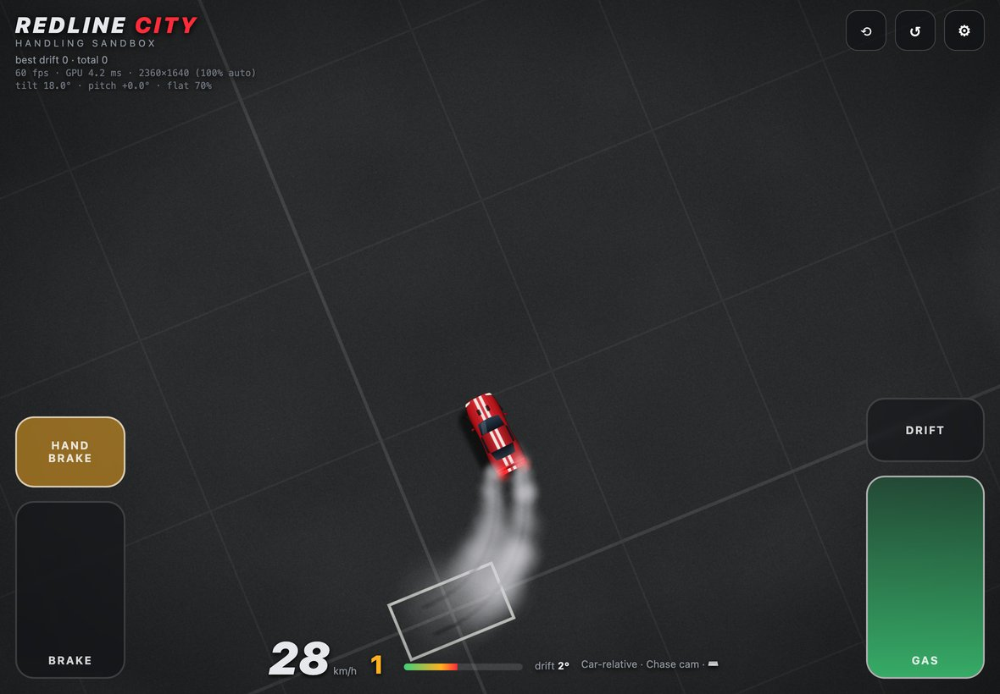

# Redline City: handling sandbox

Top-down arcade driving in WebGPU. This first milestone is a 400 m × 400 m test pad (skidpad, figure-8, slalom, drag strip, barrier blocks, cones and tyre stacks) for dialling in car feel. It plays with a keyboard, a game controller, or an iPad's tilt sensor.

**▶ Play: https://redline-city.griffio-work.workers.dev**. It needs a WebGPU browser: Chrome/Edge 113+, Safari 26+ (including iPad), or Firefox 141+.


<p align="center">
  
  <br><sub>The whole sandbox from above: drag strip, barrier blocks, slalom, skidpad and figure-8.</sub>
</p>

## Contents

- [Running it](#running-it)
- [Controls](#controls)
- [Control schemes and handling](#control-schemes-and-handling)
- [Physics and assists](#physics-and-assists)
- [iPad and tablets](#ipad-and-tablets)
- [AI car detail and decals](#ai-car-detail-and-decals)
- [Sound](#sound)
- [Performance](#performance)
- [Project layout](#project-layout)

## Running it

### Locally (dev server)

```bash
npm start            # node server.mjs → http://localhost:5173
```

The dev server has no dependencies. Run `npm install` only if you want to deploy (it installs `wrangler`).

* **`.env`:** the AI features (car detail, decals, announcer) use Cloudflare Workers AI. Put an account ID and a Workers AI token in `.env`:

  ```bash
  CLOUDFLARE_API_KEY=<account id>
  COULDFLARE_API_TOKEN=<Workers AI token>
  ```

* **Keep those variable names, odd as they look.** Wrangler reads `CLOUDFLARE_API_TOKEN` from `.env` for its *own* login. Renaming the token variable to that would override your `wrangler login` and break `npm run deploy`. The server also accepts `CLOUDFLARE_ACCOUNT_ID`.
* **The token stays on the server**, so the browser never sees it.
* **Localhost only:** the server listens on localhost, because the `/api` routes spend your Workers AI allowance. Use `HOST=0.0.0.0 npm start` to share it on a LAN.
* **Limits:** AI calls are capped at 20 per minute; cached voice lines don't count.
* **Hidden files:** dotfiles and dot-directories (`.env`, `.git/…`) are never served.

### Cloudflare (with Workers AI)

```bash
npm install          # wrangler
npx wrangler login   # once
npm run deploy       # build dist/ and deploy
npm run dev:cf       # run the same Worker locally; the AI binding still runs on Cloudflare
```

* **What it is:** a Worker with static assets. `dist/` is served from the edge, and `worker/index.js` answers `/api/*` through the **Workers AI binding**, so no API token is deployed.
* **`.env` stays out of it:**
  * `dev:cf` sets `CLOUDFLARE_LOAD_DEV_VARS_FROM_DOT_ENV=false`, so wrangler doesn't inject your local `.env` into the dev Worker.
  * Deploys never upload `.env`.
* **Car detail and decals:** FLUX.2-dev returns a `data:` URL, which the browser keeps in localStorage. Nothing is stored server-side.
* **Announcer:** lines already generated by the dev server (`assets/voice/`) ship as static files and cost nothing. Any other line goes to Aura TTS.
* **Guards:**
  * AI calls must come from the site's own origin.
  * Each visitor gets 3 AI calls per minute, and the whole site 10.
  * Cloudflare's limiter is per data centre, so treat these as a brake rather than an exact cap.
* **Free-plan allowance:** the Workers **Free** plan includes 10,000 Workers AI neurons a day, about 7 FLUX.2-dev images at the 12 steps the game uses (`IMAGE_STEPS` in `worker/index.js`; 25 steps would be 3). When it's used up, the game says so, and it resets at 00:00 UTC. Workers Paid lifts the cap, and extra use is billed.
  * Cloudflare's enforcement and the dashboard's **Neurons used today** counter don't always agree: error 4006 ("allowance used up") is widely reported to persist after the reset while the dashboard shows 0/10k. The Worker logs the raw error to Workers Logs and returns its code, so a 429 can be told apart from the per-minute limiter.

### GitHub Pages

`.github/workflows/pages.yml` publishes the same `dist/` build on every push to `main`, and can also be run by hand from the Actions tab.

* **Enabling it:** go to **Settings → Pages → Build and deployment → Source** and choose **GitHub Actions**.
* **No AI backend on Pages:** everything else works. The client probes `api/health` and turns off the AI button and announcer instead of erroring. On `*.github.io` it skips the probe entirely.

## Controls

| | Keyboard | Controller | iPad |
|---|---|---|---|
| Steer | `A` `D` / ← → | Left stick | Tilt like a wheel |
| Throttle | `W` / ↑ | RT | Right pedal |
| Brake / reverse | `S` / ↓ (hold at a stop to reverse) | LT | Left pedal |
| Handbrake | `Space` | A | Button above the brake |
| Drift (scheme 4) | `Shift` | B / RB | Button above the gas |
| Brake (point-to-steer) | `X` / `Ctrl` | X | Left pedal |
| Reset car | `R` | Y / D-pad ↑ | ↺ |
| Control scheme | `1`–`5` | View | Settings |
| Camera | `C` | LB | Settings |
| Handling preset | `P` | D-pad ◀ ▶ | Settings |
| Settings panel | `Tab` | Menu | ⚙ |
| Other | `M` mute · `K` clear skids · `H` help · `F` perf readout | | ⟲ recentre tilt |

* **Rumble:** controllers rumble on tyre slip, lockups and impacts. The rumble stays silent while the tyres grip.
* **Analog sticks:** they use a radial dead zone and a response curve.
* **Keyboard steering:** it ramps in, and returns faster when you let go.

## Control schemes and handling

1. **Car-relative · chase cam** *(recommended)*: the camera eases round to the travel direction rather than the nose, so spins stay readable.
2. **Car-relative · north-up:** classic GTA 2 / Micro Machines. Steering feels inverted when you drive down the screen.
3. **Point-to-steer:** push the stick or arrows in the direction you want to travel on screen. Auto-throttle drives.
4. **Drift button + mini-turbo:** hold Shift/B/RB to lock into a slide, steer to tighten or widen it, release for a 3-stage boost.
5. **Retro rotational:** no tyre model. Steering spins the car and the velocity lags the nose.

* **Handling presets:** Balanced, Grip / Sim, Drift Car, Arcade Grip, Ice / Rally.
* **Saved settings:** every setting is saved in localStorage. *Copy tuning JSON* in the panel exports a config to bake into the defaults.


## Physics and assists

**The "real" half** is a two-axle rigid body:

* **Tyre grip:** lateral force comes from the slip angle through a simplified Pacejka curve, `sin(C·atan(Bα))`. Grip peaks at `peakSlipDeg`, then falls to a sliding plateau (`slideFalloff`).
* **Weight transfer:** braking loads the front, which helps turn-in and trail-brake rotation. Lifting off unloads the rear, which gives lift-off oversteer.
* **Friction circle per axle:** wheelspin eats lateral grip, which gives power oversteer on RWD.
* **Lockup without ABS:** locked tyres slide along their velocity, so you can't steer. ABS caps brake force at the grip limit.
* **Handbrake:** locks the rear axle.
* **Gearbox:** automatic, with a torque curve, a rev limiter, and reverse (hold brake at a stop).

**The "fun" half** is a set of assists, each a slider:

* **Auto-countersteer:** the front wheels self-align to the travel direction, like caster.
* **Spin protection:** a soft torque past `maxDriftDeg`.
* **Slide speed retention:** sideways scrub gives back some speed.
* **Stability control.**
* **Steer-to-grip limiter** (Forza-style): a full stick doesn't plough the front.
* **Countersteer exemption:** the player's own countersteer isn't reduced by speed-sensitive steering.

## iPad and tablets

On touch devices, on-screen controls switch on automatically. Tap **Tap to start** to grant motion-sensor access (iOS asks here), unlock sound, and calibrate to however you're holding the device.

<p align="center"></p>

* **Modes** (panel → *Touch & tilt*):
  * **Tilt steer + pedals** (default). Slide up a pedal for more.
  * **Full tilt:** tilt the top edge away to accelerate and pull it back to brake, with a dead zone and range around the calibrated angle.
  * **Touch buttons only:** ◀ ▶ arrows replace tilt steering.
* **Jerk back = handbrake** is optional. It detects a fast pull of the top edge toward you, at sensor rate. Steering holds its pre-flick value, so the yank doesn't jerk the wheel.
* **How steering is measured:** it's the rotation of gravity within the screen's plane, relative to the calibrated neutral.
  * That makes it independent of which way round the iPad is held in landscape, of how far back it's tilted, and of the iOS/Android sign conventions.
  * It fades out when the device lies flat, and recentres automatically when the device is turned round.
* **Fallbacks:** without a motion sensor, or if access is denied, ◀ ▶ arrows appear. Bluetooth controllers and keyboards keep working. Safari has no vibration, so there's no rumble on iPad.
* **Motion sensors need HTTPS.** The Cloudflare and GitHub Pages deploys both work as-is. The local dev server only listens on this machine.
* **Full screen:** *Add to Home Screen* in Safari runs it full-screen.

## AI car detail and decals

Panel → *Car look & AI detail*:

1. **Choose a look.** Pick the paint and racing stripes, and a **decal / livery**: a preset (flames, race number, carbon hood, checkered, touring, drift style) or your own description. Editing the decal rewrites the prompt.
2. **Generate.** Press **✨ Detail car with AI**. The software-rendered car is drawn nose-up at 512×1024 and sent with the prompt to `@cf/black-forest-labs/flux-2-dev` as `input_image_0`.
3. **Clip.** The result is clipped back to the procedural silhouette, so the sprite always matches the collision box.

* **Where results go:** the dev server saves them to `assets/generated/`. The Cloudflare deploy keeps them in the browser.
* **Stale results:** a result that arrives after you've changed the paint or decal is discarded.
* **Model choice:** the FLUX.2 klein models flag nearly every car prompt; dev works.

<p align="center"></p>

* **Announcer:** Workers AI has no sound-effect model, only TTS. Drift callouts use `@cf/deepgram/aura-2-en`.

## Sound

Engine and tyre sounds are real recordings from Freesound, all CC0. Sources are listed in [`assets/audio/CREDITS.md`](assets/audio/CREDITS.md).

* **V8 engine:**
  * **The loops:** seamless RPM loops cut from a 1700 hp V8's full-load dyno pull (3,100–7,000 rpm) and its overrun, plus a '75 Firebird V8 idle and low-rev loop.
  * **How they were made:** each loop was pitch-tracked from its harmonic comb (V8 half-order spacing b, so rpm = 120·b), time-warped to constant pitch, and trimmed to a whole number of engine cycles so the seam is inaudible.
  * **At runtime:** the on-load and off-load layer stacks blend by throttle. The two loops either side of the current RPM are equal-power crossfaded and pitch-corrected (`playbackRate = rpm / loopRpm`).
* **Tyres:**
  * a Chrysler cornering-squeal loop, driven by sideways slip and pitched down for locked-wheel skids;
  * a burnout loop for wheelspin;
  * a Volvo handbrake-yank one-shot.
* **Verification:** the image below is a spectrogram of the game's own audio, recorded while driving through the gears. The overlaid lines are the V8 orders expected from the game's RPM, and the recorded harmonics follow them through each pull, shift and lift-off. The tyre squeal and burnout show up in the 1–2 kHz band.

  

* **Regenerating loops:** `tools/audio/` holds the scraper, analyser and loop maker. Put the source previews in `tools/audio/sources/<freesound-id>.mp3`, then run `python3 tools/audio/make_loops.py tools/audio/engine_loops.json assets/audio/engine`. This needs numpy and ffmpeg.

## Performance

Profiled on the dev machine's Intel UHD 630 at full Retina resolution (3080×2160):

* **Ground pass:** the only heavy pass. Its noise comes from a baked 256² tileable, mipmapped texture instead of per-pixel value noise, and each paint feature is gated by a bounds test.
* **Resolution → Auto** (the default): render scale adjusts to hold about 60 fps. It drops only when frames are slow *and* the GPU is the bottleneck, then creeps back up. Fixed 100/75/50% options are also available.
* **Culling:** off-screen sprites are culled.
* **HUD:** writes to the DOM only when a value changes.
* **Input lag:** the renderer stops queueing frames when the GPU is two behind, so lag doesn't build up.
* **Perf readout:** `F` toggles fps, GPU ms (from timestamp queries) and render size. On iPad it also shows the live tilt and pitch.

## Project layout

| File | What |
|---|---|
| `src/main.js` | Game loop, settings persistence, skid marks, particles, drift scoring |
| `src/physics/car.js` | Vehicle model + tuning presets |
| `src/physics/world.js` | Sandbox layout, SAT car-vs-barrier, impulse collisions with cones and tyres |
| `src/controls.js` | The 5 control schemes (input → car commands) |
| `src/input.js` | Keyboard ramps, radial dead zone + response curve, Gamepad API, dual-motor rumble |
| `src/touch.js` | Tablet controls: tilt steering, touch pedals, full-tilt and jerk-handbrake modes |
| `src/camera.js` | Chase / locked / north-up camera, look-ahead, speed zoom, shake |
| `src/gpu/renderer.js` | WebGPU: procedural ground shader, persistent skid-mark render target, instanced sprites |
| `src/sprites.js` | Canvas 2D (software) sprite atlas, decal presets, AI detail pipeline |
| `src/audio.js` | Sample-based V8 engine + tyres, synth fallback, AI announcer |
| `src/ui.js` | Tuning panel, HUD, telemetry widget |
| `src/api.js` | Detects whether an AI backend is reachable |
| `server.mjs` | Dev server: static files + `/api/*` via the Workers AI REST API (`.env` token) |
| `worker/index.js`, `wrangler.jsonc` | Cloudflare deploy: static assets + `/api/*` via the Workers AI binding |
| `scripts/build.mjs` | Builds `dist/`, the browser-facing files only (used by both deploys) |
| `.github/workflows/pages.yml` | GitHub Pages deploy |
| `tools/audio/` | Freesound scraper, pitch analysis and loop maker for the engine/tyre sounds |
